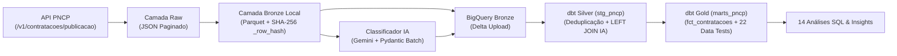

# Pipeline ELT & Analytics — Compras Públicas de TIC em Santos/SP (PNCP)

Projeto ponta a ponta de **Engenharia de Dados** e **Analytics Engineering** que extrai, classifica semanticamente via IA e analisa as contratações públicas de **Tecnologia da Informação e Comunicação (TIC)** divulgadas no [Portal Nacional de Contratações Públicas (PNCP)](https://www.gov.br/pncp/pt-br) no município de **Santos/SP** (`codigoMunicipioIbge = 3548500`, período 2024–2026).

Toda a arquitetura foi construída para rodar **100% no Free Tier** (Google BigQuery Sandbox + Google AI Studio), com autenticação *keyless* (ADC), controles de idempotência e validação estatística.

---

## Sumário da Documentação

Abaixo está o índice completo dos documentos técnicos e analíticos do repositório. A capa deste `README` resume as duas frentes principais do projeto (**Engenharia** e **Analytics**):

| Frente | Documento | Conteúdo Principal |
| :--- | :--- | :--- |
| **Contexto Geral** | [`docs/project_context.md`](docs/project_context.md) | Problema de negócio, escopo da API do PNCP e desenho da arquitetura Medalhão. |
| **Engenharia** | [`docs/eng_features.md`](docs/eng_features.md) | Idempotência (`_row_hash`), carga Delta no BigQuery, classificação em lote com Gemini + Pydantic e orquestração. |
| **Engenharia / Roadmap** | [`docs/future_features.md`](docs/future_features.md) | Evolução planejada: ingestão incremental (*High Watermark* / *Sliding Window*) e extração dos endpoints `/itens` e `/resultados`. |
| **Estatística & IA** | [`docs/ai_evaluation_sample.md`](docs/ai_evaluation_sample.md) | Auditoria manual e cálculo de precisão por Amostragem Aleatória Estratificada ($n = 50$). |
| **Analytics / Modelagem** | [`docs/analysis_decisions.md`](docs/analysis_decisions.md) | Regras de negócio da tabela fato `fct_contratacoes` e mapeamento das 14 perguntas norteadoras. |
| **Analytics / SQL** | [`dbt_pncp/analyses/resultados_analises.md`](dbt_pncp/analyses/resultados_analises.md) | Tabelas de saída das 14 consultas SQL executadas no BigQuery, divididas em 5 eixos. |
| **Analytics / Negócio** | [`docs/insights.md`](docs/insights.md) | **Principais insights**, comparativo com benchmarks externos (BreveIA, TCU, Enap, TCESP) e hipóteses de melhoria. |

---

## Arquitetura e Stack Tecnológica



- **Linguagem & Qualidade de Código:** Python 3.12 (`uv`), `ruff`
- **Ingestão & Armazenamento Local:** `requests` (`HTTPAdapter` + `Retry`), `pandas`, `pyarrow` (Parquet)
- **Classificação Semântica (LLM):** `google-genai` (`gemini-3.5-flash-lite`), `pydantic` (*Structured Outputs*), `tenacity`
- **Infraestrutura como Código (IaC):** Terraform (`hashicorp/google`)
- **Data Warehouse & Modelagem:** Google BigQuery (`bronze_pncp`, `stg_pncp`, `marts_pncp`), `dbt-core` & `dbt-bigquery`

---

## Frente 1 — Engenharia de Dados & Classificação via IA

Detalhes completos em [`docs/eng_features.md`](docs/eng_features.md).

1. **Extração Resiliente e Normalização Bronze (`src/ingest/`):**
   - Consumo paginado do endpoint `/v1/contratacoes/publicacao` dividido em janelas semestrais e 5 modalidades de contratação (`ingest_pncp.py`).
   - Achatamento do JSON aninhado para Parquet (`to_parquet.py`) com geração do hash SHA-256 (`_row_hash`) **antes** da inclusão de metadados de linhagem (`_load_date`, `_ingested_at`).
2. **Enriquecimento Semântico com LLM em Lote (`src/classification/`):**
   - O PNCP não possui uma flag nativa que isole contratações de TI no cabeçalho do processo, e filtros por Regex falham em ambiguidades comuns do setor público (*"monitor multiparamétrico cirúrgico"*, *"Dia do Servidor Público"*, *"licença ambiental"*).
   - Os objetos de compra (`5.176` processos únicos) são avaliados pelo Gemini em lotes de 50 registros forçando o contrato Pydantic `BatchClassification` (`Literal` restrito a 5 categorias), com *checkpoint* incremental em Parquet. Isso elevou a identificação de processos de TIC em **+75,6%** frente ao filtro léxico (de `201` para `353` processos).
3. **Carga Incremental Delta no BigQuery e Governança dbt (`src/load/`, `terraform/`, `dbt_pncp/`):**
   - O `load_to_bigquery.py` consulta as chaves já existentes no BigQuery (`_row_hash` para contratações e `numero_controle_pncp` para a classificação IA) e envia apenas registros novos ou atualizados.
   - O Terraform provisiona os datasets com expiração ajustada aos limites do BigQuery Sandbox (50 dias), e o dbt constrói a camada Silver (`stg_contratacoes`) e a tabela fato Gold (`fct_contratacoes`) validada por **22 testes de qualidade** (`unique`, `not_null`, `accepted_values`).

---

## Frente 2 — Analytics, Validação Estatística & Insights de Negócio

Detalhes completos em [`docs/ai_evaluation_sample.md`](docs/ai_evaluation_sample.md), [`docs/analysis_decisions.md`](docs/analysis_decisions.md) e [`docs/insights.md`](docs/insights.md).

### 2.1 Validação Estatística do Classificador (`n = 50`)
Para comprovar a confiabilidade da camada Gold sem auditar manualmente milhares de linhas, foi aplicada uma **Amostragem Aleatória Estratificada** (`evaluate_sample.py`, `random_state=42`, $n_h = 10$ por estrato):

| Estrato ($h$) | Total na Base ($N_h$) | Peso TIC ($W_h$) | Amostra ($n_h$) | Precisão Binária (`is_tic`) | Precisão de Subcategoria |
| :--- | :---: | :---: | :---: | :---: | :---: |
| **Hardware e Equipamentos** | 190 | 53,8% | 10 | **90%** *(9/10)* | **90%** *(9/10)* |
| **Redes, Cloud e Segurança** | 67 | 19,0% | 10 | **100%** *(10/10)* | **90%** *(9/10)* |
| **Serviços de TI** | 52 | 14,7% | 10 | **80%** *(8/10)* | **80%** *(8/10)* |
| **Software e Licenciamento** | 44 | 12,5% | 10 | **80%** *(8/10)* | **80%** *(8/10)* |
| **Não-TIC** | 4.835 | — | 10 | **100%** *(10/10)* | **100%** *(10/10)* |

- **Precisão Positiva Ponderada ($\hat{P}_{st}$):** `89,2%` ($\pm 4,6\%$ de erro padrão)
- **Fidelidade de Subcategoria (entre Verdadeiros Positivos):** `97,1%` ($34/35$)
- **Acurácia Global Ponderada:** `99,26%`

### 2.2 Principais Achados nas Compras de TIC de Santos (2024–2026)
A partir das 14 consultas analíticas em [`dbt_pncp/analyses/`](dbt_pncp/analyses/resultados_analises.md), os dados revelaram 5 pontos centrais:

1. **Inversão entre Esforço Operacional e Orçamento (Eixo 0):**
   - Nos **247 processos válidos** (`Homologada` + `Em Andamento`), o volume soma **R$ 260,29 milhões estimados** e **R$ 143,31 milhões homologados** (ticket médio de **R$ 604,67 mil**).
   - **Hardware e Equipamentos** consome **54,25% dos editais** (134 processos), mas representa só **11,23% do valor homologado** (`R$ 16,10M`). Já **Serviços de TI** tem apenas **14,17% dos processos** (35 editais), mas concentra **43,24% do orçamento** (`R$ 61,97M`), refletindo contratos plurianuais complexos (sustentação de CCO, monitoramento e infraestrutura).
2. **Economia de R$ 81,49 Milhões e o "Paradoxo do Deságio" (Eixo 1):**
   - A economia bruta acumulada em TIC somou **R$ 81,49 milhões** entre 2024 e 2026 (`R$ 49,89M` apenas em 2026), com o deságio ponderado subindo de `17,43%` (2024) para `40,22%` (2026).
   - Enquanto agregadores nacionais que incluem contratações diretas apontam deságio médio de `7,0%` em TI ([BreveIA](https://www.breveia.com.br/mercado/tecnologia/)), o recorte estrito de **licitações competitivas** em Santos fica entre **30,85% e 41,98%** (alinhado à literatura do TCU/Enap para pregões).
   - Descontos extremos de **76% a 93,34%** concentrados em **Redes, Cloud e Segurança** (links IP dedicados e telefonia STFC) indicam **superestimativa na pesquisa de preços inicial**, e não apenas competição de lances.
3. **Gargalo de Homologação (Eixo 1):**
   - Dos **353 processos de TIC** abertos, **28,05% (99 editais)** terminaram **Encerrados sem Homologação**, deixando **R$ 89,32 milhões estimados** travados pelo caminho.
4. **Quem Puxa a Escala no Município e Efeito do Porte (Eixo 3):**
   - A **Autoridade Portuária de Santos (CODESP/APS, esfera Federal)** responde sozinha por **~44% de todo o valor homologado** (`R$ 62,87M` em apenas 11 processos de modernização portuária), seguida pela **Prefeitura Municipal de Santos** (`R$ 59,92M` somando suas 3 principais unidades e liderando em quantidade de processos).
   - Os **35 processos de Grande Porte (> R$ 500 mil)** responderam por **95,7% de toda a economia em reais** (`R$ 77,78M`), embora tenham média simples percentual menor (`29,99%`) que compras de pequeno/médio porte (`35%–36%`).
5. **Oportunidade de Consolidação via Atas de Registro de Preços — SRP (Eixos 2 e 4):**
   - Apenas **7,89% dos Pregões Eletrônicos** de TIC utilizam SRP, ao mesmo tempo em que a Prefeitura realizou dezenas de Dispensas avulsas de Hardware no período. Centralizar a compra de equipamentos recorrentes em Atas de Registro de Preços e calibrar a cesta de preços de Telecom/Cloud com bases públicas homologadas são as duas maiores oportunidades práticas de eficiência identificadas.

---

## Estrutura do Repositório

```text
├── config/
│   └── config.yaml                # Parâmetros centralizados (API, Storage, BigQuery e LLM)
├── src/
│   ├── ingest/
│   │   ├── ingest_pncp.py         # Extração paginada da API PNCP em janelas semestrais
│   │   └── to_parquet.py          # Normalização JSON -> Parquet com hash SHA-256
│   ├── classification/
│   │   ├── schemas.py             # Contratos Pydantic (ClassifiedItem / BatchClassification)
│   │   ├── prompts.py             # System prompt calibrado para compras públicas de TIC
│   │   ├── classify_batch.py      # Chamada em lote ao Gemini com retry exponencial
│   │   ├── run_classification.py  # Orquestrador incremental com checkpoint em Parquet
│   │   └── evaluate_sample.py     # Cálculo de precisão estratificada e erro padrão (n=50)
│   ├── load/
│   │   └── load_to_bigquery.py    # Carga incremental (Delta) para o BigQuery
│   └── utils/
│       ├── load_config.py         # Leitor de configuração YAML
│       ├── llm_client.py          # Inicialização do cliente Google GenAI
│       └── export_analyses.py     # Compilador e executor das 14 análises SQL para Markdown
├── terraform/
│   ├── main.tf                    # Provider Google Cloud lendo config.yaml
│   └── bigquery.tf                # Provisionamento dos datasets Bronze, Silver e Gold
├── dbt_pncp/
│   ├── models/
│   │   ├── staging/               # View stg_contratacoes + sources.yml + schema.yml
│   │   └── marts/                 # Tabela física fct_contratacoes + schema.yml
│   ├── analyses/                  # 14 consultas SQL (Eixos 0 a 4) + resultados_analises.md
│   └── macros/
│       └── generate_schema_name.sql
├── docs/                          # Documentação completa de engenharia, validação e insights
└── main.py                        # Orquestrador central do pipeline Python
```

---

## Como Executar

```powershell
# 1. Autenticação keyless no GCP e variáveis de ambiente
gcloud auth application-default login
Copy-Item .env-example .env

# 2. Provisionar datasets no BigQuery (Terraform)
terraform -chdir=terraform init
terraform -chdir=terraform apply

# 3. Executar pipeline Python (Ingestão -> Bronze Parquet -> Classificação IA -> BigQuery)
uv run python main.py
# (Opcional) Pular extração da API se o Parquet Bronze já existir localmente:
uv run python main.py --skip-ingest

# 4. Construir modelos Silver/Gold e rodar os 22 testes de qualidade (dbt)
uv run dbt build --project-dir dbt_pncp --profiles-dir dbt_pncp

# 5. Compilar e executar as 14 consultas analíticas gerando resultados_analises.md
uv run python -m src.utils.export_analyses
```
