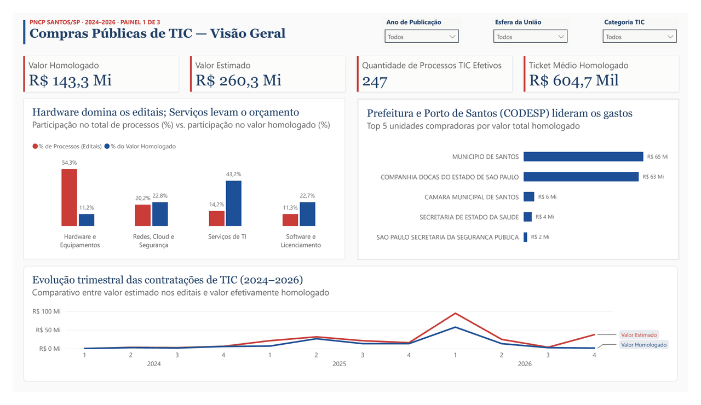
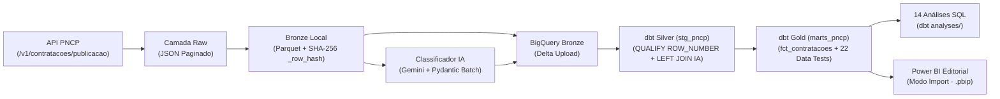
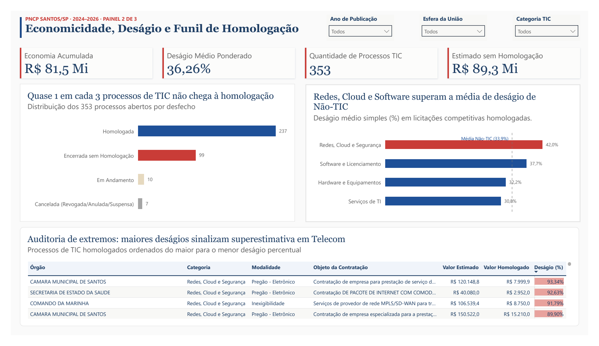
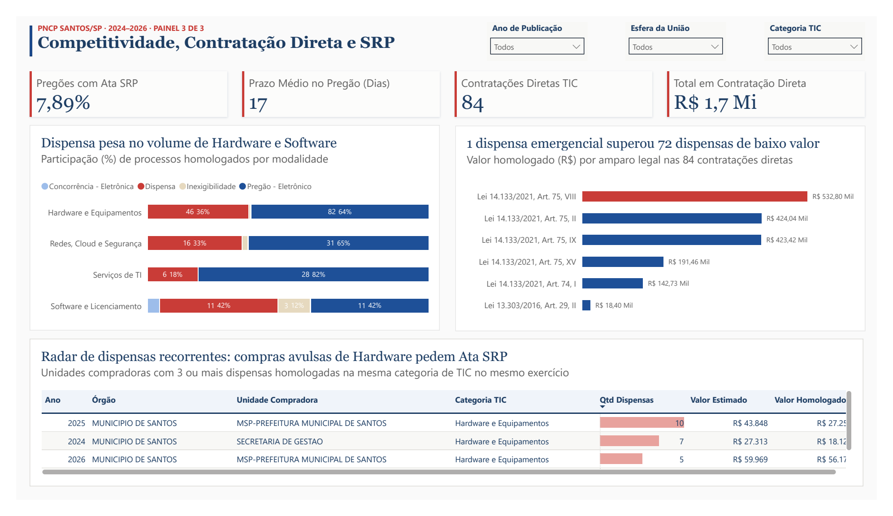

# PNCP TIC Analytics — Compras Públicas de Tecnologia em Santos/SP (2024–2026)


-1D3D63?style=flat-square)


-E6D9BF?style=flat-square)

Pipeline ponta a ponta de **Engenharia de Dados**, **Analytics Engineering** e **Business Intelligence** construído para responder a uma pergunta real de transparência e gestão pública: **como a cidade de Santos/SP compra tecnologia com dinheiro público?**

O projeto extrai **5.176 licitações** da API oficial do [Portal Nacional de Contratações Públicas (PNCP)](https://www.gov.br/pncp/pt-br) (`codigoMunicipioIbge = 3548500`), aplica classificação semântica em lote via **LLM (Gemini + Pydantic)** auditada por **amostragem estatística estratificada**, modela a camada analítica no **BigQuery com dbt + Terraform** e entrega um **dashboard editorial de 3 páginas no Power BI** — rodando **100% no Free Tier** com autenticação *keyless* (ADC).



> **Visualização rápida sem Power BI instalado:** abra o relatório completo em PDF clicando em [`dashboard/pncp_santos_project.pdf`](dashboard/pncp_santos_project.pdf).

---

## Números-Chave do Projeto

| **5.176** | **R$ 143,3 Mi** | **89,2%** *(±5,97%)* | **R$ 81,5 Mi** | **22 Testes** |
| :---: | :---: | :---: | :---: | :---: |
| Licitações processadas (TIC + Não-TIC) | Homologados em TIC em Santos/SP | Precisão ponderada da IA ($n = 50$) | Economia acumulada (2024–2026) | Data tests automatizados no `dbt build` |

---

## Sumário da Documentação Completa

Este `README` conta a história do projeto e resume cada fase de forma objetiva. Para se aprofundar nos detalhes técnicos, metodológicos ou de negócio, navegue pela documentação completa:

| Frente | Documento | O que você encontra lá |
| :--- | :--- | :--- |
| **Domínio & Escopo** | [`docs/project_context.md`](docs/project_context.md) | Ciclo da Lei nº 14.133/2021, dicionário completo da API do PNCP e escopo da extração. |
| **Engenharia de Dados** | [`docs/eng_features.md`](docs/eng_features.md) | Idempotência (`_row_hash`), carga Delta no BigQuery, LLM em lote, Terraform, dbt e `.pbip`. |
| **Estatística & IA** | [`docs/ai_evaluation_sample.md`](docs/ai_evaluation_sample.md) | Auditoria manual completa das 50 contratações sorteadas na Amostragem Aleatória Estratificada. |
| **Modelagem Gold** | [`docs/analysis_decisions.md`](docs/analysis_decisions.md) | Regras de negócio da tabela fato `fct_contratacoes` e mapeamento das 14 perguntas norteadoras. |
| **Resultados SQL** | [`dbt_pncp/analyses/resultados_analises.md`](dbt_pncp/analyses/resultados_analises.md) | Tabelas formatadas com as saídas reais das 14 consultas SQL executadas no BigQuery. |
| **Insights de Negócio** | [`docs/insights.md`](docs/insights.md) | Leitura executiva dos 4 eixos, comparativo com benchmarks (BreveIA, TCU, TCESP) e ideias de melhoria. |
| **Dashboard (PDF)** | [`dashboard/pncp_santos_project.pdf`](dashboard/pncp_santos_project.pdf) | Exportação em PDF das 3 páginas do painel editorial no Power BI. |
| **Capítulo Extra / V2** | [`docs/future_features.md`](docs/future_features.md) | Próxima evolução planejada: Apache Airflow local (`docker-compose`), *High Watermark* e `/itens`. |

---

## A História do Projeto (Como Ele Foi Nascendo aos Poucos)

Em vez de baixar um CSV pronto do Kaggle, a ideia aqui foi encarar uma **API governamental brasileira real — com todas as suas imperfeições** — e ir resolvendo cada obstáculo conforme ele aparecia:

1. **O primeiro obstáculo (sem botão "filtrar TI"):** O PNCP não traz uma coluna dizendo se um edital é de tecnologia. A primeira tentativa usando filtros por palavras-chave (Regex) no texto livre falhou rápido: palavras como *"monitor"*, *"servidor"* e *"licença"* puxavam monitor multiparamétrico cirúrgico, festa do Dia do Servidor Público e licença ambiental. Isso motivou a criação de um classificador semântico em lote com **Gemini + Pydantic**.
2. **A recusa em tratar a IA como caixa-preta:** Usar LLM sem medir erro é arriscado. Em vez de confiar cegamente no resultado, sorteamos uma **amostra aleatória estratificada ($n = 50$)**, auditamos manualmente edital por edital e medimos a precisão real (**89,2% ± 5,97%**), usando os erros de fronteira (como *drone de larvicida* e *TV Câmara*) para calibrar o prompt.
3. **O impasse do Free Tier (BigQuery Sandbox):** Sem cartão de crédito no GCP, o BigQuery Sandbox expira tabelas após 60 dias. Em vez de ver isso como bloqueio, transformamos os **Parquets locais com `_row_hash` (SHA-256)** na fonte imutável da verdade: todo o Data Warehouse pode ser reconstruído do zero em segundos (`main.py --skip-ingest`), sem gastar nenhum token novo de IA.
4. **O susto de qualidade de dados na análise:** Ao montar o ranking dos maiores compradores de TIC em Santos, parecia inicialmente que a Autoridade Portuária (CODESP) gastava o dobro da Prefeitura. Investigando os nomes das unidades, descobrimos que o PNCP fragmenta a Prefeitura em **6 grafias diferentes de unidades compradoras** — quando unificamos por órgão (`orgao_razao_social`), o **Município de Santos (R$ 65,39M)** assumiu o **1º lugar** frente à **CODESP (R$ 62,87M)**.
5. **Fechando a vitrine com design editorial:** Para o dashboard não parecer um painel poluído cheio de caixas coloridas (e não quebrar se o Sandbox expirar), conectamos o Power BI em modo **Import**, aplicamos uma paleta inspirada em *Our World in Data* e *The Pudding* e versionamos o relatório em texto aberto no Git no formato **`.pbip`**.

---

## Arquitetura Geral



**Stack:** Python 3.12 (`uv`, `ruff`), `requests`, `pandas`, `pyarrow` (Parquet), `google-genai` (`gemini-3.5-flash-lite`), `pydantic`, `tenacity`, Terraform, Google BigQuery, `dbt-core` / `dbt-bigquery` e Power BI Desktop (`.pbip`).

---

## Fase 1 — Ingestão Resiliente & Camada Bronze Idempotente

> Documentação detalhada: [`docs/project_context.md`](docs/project_context.md) e [`docs/eng_features.md`](docs/eng_features.md)

- **Por que extrair todas as 5.176 contratações (e não só TI)?** Sem trazer o restante das compras do município (`Não-TIC`), seria impossível responder se tecnologia gera mais ou menos deságio do que as compras comuns da cidade.
- **Extração em janelas (`src/ingest/ingest_pncp.py`):** Consome `/v1/contratacoes/publicacao` em janelas semestrais (`6MS`) e 5 modalidades, com `HTTPAdapter` + `Retry` para lidar com instabilidades da API pública.
- **Idempotência antes dos metadados (`src/ingest/to_parquet.py`):** Os JSONs brutos ficam intocados em `data/raw/`. Ao normalizar para Parquet por `load_date`, o hash SHA-256 (`_row_hash`) é gerado sobre o payload original **antes** de injetar `_load_date` e `_ingested_at`. Se a licitação não mudou na API, o hash permanece idêntico.

---

## Fase 2 — Classificação Semântica com IA & Validação Estatística

> Documentação detalhada: [`docs/ai_evaluation_sample.md`](docs/ai_evaluation_sample.md)

- **Lotes estruturados com Pydantic (`src/classification/`):** Envia lotes de 50 objetos para o `gemini-3.5-flash-lite` exigindo aderência ao schema `BatchClassification` (`Literal` restrito às 5 categorias do domínio). Os resultados são salvos com checkpoint em `classificacao_tic_ia.parquet` — cada ID passa pelo LLM uma única vez, gerando **+75,6%** mais processos de TIC detectados frente ao Regex (de `201` para `353` processos).
- **Auditoria Estatística (`evaluate_sample.py`, `random_state=42`, $n = 50$):**

| Estrato ($h$) | Total na Base ($N_h$) | Peso TIC ($W_h$) | Amostra ($n_h$) | Precisão Binária (`is_tic`) | Precisão de Subcategoria |
| :--- | :---: | :---: | :---: | :---: | :---: |
| **Hardware e Equipamentos** | 190 | 53,8% | 10 | **90%** *(9/10)* | **90%** *(9/10)* |
| **Redes, Cloud e Segurança** | 67 | 19,0% | 10 | **100%** *(10/10)* | **90%** *(9/10)* |
| **Serviços de TI** | 52 | 14,7% | 10 | **80%** *(8/10)* | **80%** *(8/10)* |
| **Software e Licenciamento** | 44 | 12,5% | 10 | **80%** *(8/10)* | **80%** *(8/10)* |
| **Não-TIC** | 4.835 | — | 10 | **100%** *(10/10)* | **100%** *(10/10)* |

- **Precisão Positiva Ponderada ($\hat{P}_{st}$):** **`89,2%`** ($\pm 5,97\%$ de erro padrão estratificado)
- **Fidelidade de Subcategoria (entre Verdadeiros Positivos):** **`97,1%`** ($34/35$)
- **Acurácia Global Ponderada ($N = 5.188$):** **`99,26%`**

---

## Fase 3 — Infraestrutura (Terraform), BigQuery Delta & dbt (Silver/Gold)

> Documentação detalhada: [`docs/eng_features.md`](docs/eng_features.md) e [`docs/analysis_decisions.md`](docs/analysis_decisions.md)

- **IaC + Autenticação Keyless (`terraform/`):** Datasets `bronze_pncp`, `stg_pncp` e `marts_pncp` provisionados via Terraform usando Application Default Credentials (ADC — zero arquivos `.json` de chave em disco) e expiração explícita de **50 dias** compatível com o BigQuery Sandbox.
- **Carga Delta (`src/load/load_to_bigquery.py`):** `_upload_delta()` compara `_row_hash` (contratações) e `numero_controle_pncp` (classificações) no BigQuery antes de dar `WRITE_APPEND`, permitindo reconstruir o banco em segundos via `main.py --skip-ingest`.
- **Transformação e Qualidade no dbt (`dbt_pncp/`):**
  - **Silver (`stg_contratacoes`):** view que padroniza tipos/nomes em `snake_case`, faz `LEFT JOIN` com a IA e isola a versão mais atual de cada processo com `QUALIFY ROW_NUMBER() OVER (PARTITION BY numero_controle_pncp ORDER BY data_atualizacao_global DESC) = 1`.
  - **Gold (`fct_contratacoes`):** tabela física com `status_processo` (impedindo que valor homologado nulo vire falso desconto de 100%), deságio protegido por `SAFE_DIVIDE`, `grupo_competitividade`, `porte_contratacao`, esfera e janela de propostas.
  - **22 Data Tests:** `unique`, `not_null` e `accepted_values` validando chaves primárias pós-join e regras de domínio a cada `dbt build`.

---

## Fase 4 — Analytics Engineering (14 Queries SQL) & Principais Insights

> Consultas e saídas: [`dbt_pncp/analyses/resultados_analises.md`](dbt_pncp/analyses/resultados_analises.md) · Análise completa e fontes externas: [`docs/insights.md`](docs/insights.md)

A camada Gold foi explorada por meio de **14 consultas SQL** organizadas em 5 eixos (executadas e exportadas automaticamente pelo `src/utils/export_analyses.py`). Os 5 achados mais relevantes para negócio e gestão pública:

1. **Inversão Volume vs. Orçamento:** Nos **247 processos válidos** (`R$ 260,29M` estimados / `R$ 143,31M` homologados), **Hardware** consome **54,25%** da abertura de editais para representar apenas **11,23%** do orçamento (`R$ 16,10M`), enquanto **Serviços de TI** (**14,17%** dos processos) concentra **43,24%** do dinheiro (`R$ 61,97M`).
2. **Prefeitura e Porto de Santos concentram 89,5% do gasto:** Consolidando por `orgao_razao_social`, o **Município de Santos** (`R$ 65,39M` pulverizados em 91 processos / 6 unidades) e a **CODESP / Autoridade Portuária** (`R$ 62,87M` concentrados em apenas 11 megacontratos federais) lideram juntos quase todo o orçamento de TIC da cidade.
3. **Economia de R$ 81,49M e o "Paradoxo do Deságio":** O deságio médio em licitações competitivas de TIC ficou entre **30,85% e 41,98%** (acima da média nacional agregada de 7% do BreveIA por isolarmos apenas modalidades competitivas sem dispensas zeradas). Contudo, descontos extremos de **76% a 93,34%** em Telecom/Cloud sinalizam **superestimativa na pesquisa de preços inicial**, não apenas disputa acirrada.
4. **Quase R$ 90 milhões parados no funil:** Dos **353 processos de TIC** abertos desde 2024, **28,05% (99 editais, R$ 89,32M estimados)** encerraram sem homologação — indicando alto retrabalho administrativo.
5. **Oportunidade prática em Atas de Registro de Preços (SRP):** Apenas **7,89%** dos Pregões Eletrônicos de TIC usam SRP, mesmo com a Prefeitura abrindo dezenas de dispensas avulsas de Hardware no mesmo ano (10 dispensas em 2025 e 5 em 2026). Consolidar itens recorrentes em Atas SRP reduziria drasticamente o custo operacional.

---

## Fase 5 — Dashboard Editorial em Power BI (`.pbip`)

> Arquivos do projeto: [`dashboard/pncp_santos_project.pbip`](dashboard/pncp_santos_project.pbip) · Tema: [`dashboard/pncp_theme.json`](dashboard/pncp_theme.json) · PDF completo: [`dashboard/pncp_santos_project.pdf`](dashboard/pncp_santos_project.pdf)

O relatório de 3 páginas foi conectado à `marts_pncp.fct_contratacoes` em **modo Import** (para que o painel nunca quebre caso as tabelas expirem no BigQuery Sandbox), desenhado sob a estética de jornalismo de dados de **Our World in Data** e **The Pudding** (títulos que declaram o insight, paleta sóbria `#1E5098` / `#C93C37`, zero poluição visual) e versionado em Git no formato aberto **`.pbip`** (JSON + TMDL).

### Painel 1 — Visão Geral (Esforço vs. Orçamento, Top 5 Órgãos e Sazonalidade)


### Painel 2 — Economicidade, Deságio (com Benchmark Não-TIC) e Auditoria de Extremos


### Painel 3 — Competitividade, Contratação Direta, Amparos Legais e Radar de Dispensas


---

## Status do Projeto & Capítulo Extra (Evolução Pós-V1)

> Roadmap detalhado: [`docs/future_features.md`](docs/future_features.md)

A **V1 deste projeto está 100% concluída** — cobrindo da extração na API até o relatório executivo final. Como evolução técnica opcional (mantendo a filosofia Free Tier):
- **Capítulo Extra — Orquestração Local com Apache Airflow (`docker-compose`) + Ingestão Incremental:** transformar as etapas do `main.py` em tasks isoladas com *retries* rodando localmente sob demanda e substituir o backfill completo por **High Watermark com overlap** (`MAX(data_publicacao) - 15 dias`, capturando homologações tardias com *fallback* automático caso o Sandbox expire) em contraste com *Sliding Window* fixa.
- **V2 — Detalhamento de `/itens` e `/resultados`:** aproveitar os 353 IDs já filtrados pela IA para extrair preços unitários por equipamento e concentração de fornecedores (CNPJs vencedores).

---

## Estrutura do Repositório

```text
├── config/
│   └── config.yaml                  # Parâmetros centralizados (API, Storage, BigQuery e LLM)
├── src/
│   ├── ingest/
│   │   ├── ingest_pncp.py           # Extração paginada da API PNCP em janelas semestrais
│   │   └── to_parquet.py            # Normalização JSON -> Parquet com hash SHA-256
│   ├── classification/
│   │   ├── schemas.py               # Contratos Pydantic (ClassifiedItem / BatchClassification)
│   │   ├── prompts.py               # System prompt calibrado para compras públicas de TIC
│   │   ├── classify_batch.py        # Chamada em lote ao Gemini com retry exponencial
│   │   ├── run_classification.py    # Orquestrador incremental com checkpoint em Parquet
│   │   └── evaluate_sample.py       # Cálculo de precisão estratificada e erro padrão (n=50)
│   ├── load/
│   │   └── load_to_bigquery.py      # Carga incremental (Delta) para o BigQuery
│   └── utils/
│       ├── load_config.py           # Leitor de configuração YAML
│       ├── llm_client.py            # Inicialização do cliente Google GenAI
│       └── export_analyses.py       # Executor das 14 análises SQL para resultados_analises.md
├── terraform/
│   ├── main.tf                      # Provider Google Cloud lendo config.yaml
│   └── bigquery.tf                  # Provisionamento dos datasets Bronze, Silver e Gold (50d)
├── dbt_pncp/
│   ├── models/
│   │   ├── staging/                 # View stg_contratacoes + sources.yml + schema.yml
│   │   └── marts/                   # Tabela física fct_contratacoes + schema.yml (22 tests)
│   ├── analyses/                    # 14 consultas SQL (Eixos 0 a 4) + resultados_analises.md
│   └── macros/
│       └── generate_schema_name.sql
├── dashboard/
│   ├── pncp_santos_project.pbip     # Projeto Power BI versionado em texto aberto (JSON + TMDL)
│   ├── pncp_santos_project.pdf      # Exportação completa do relatório (3 páginas)
│   ├── pncp_theme.json              # Tema customizado inspirado no Our World in Data
│   └── assets/                      # Prints das 3 páginas (.png) e dashboard_tour.gif
├── docs/                            # Documentação técnica, estatística, insights e roadmap
└── main.py                          # Orquestrador central do pipeline Python
```

---

## Como Executar

```powershell
# 1. Autenticação keyless no GCP e variáveis de ambiente
gcloud auth application-default login
Copy-Item .env-example .env

# 2. Provisionar datasets no BigQuery (Terraform)
terraform -chdir=terraform init
terraform -chdir=terraform apply

# 3. Executar pipeline Python (Ingestão -> Bronze Parquet -> Classificação IA -> BigQuery)
uv run python main.py
# (Opcional) Reconstruir o BigQuery usando o Parquet Bronze e checkpoints locais (0 tokens gastos):
uv run python main.py --skip-ingest

# 4. Construir camadas Silver/Gold e rodar os 22 testes de qualidade (dbt)
uv run dbt build --project-dir dbt_pncp --profiles-dir dbt_pncp

# 5. Compilar e executar as 14 consultas SQL gerando resultados_analises.md
uv run python -m src.utils.export_analyses
```
